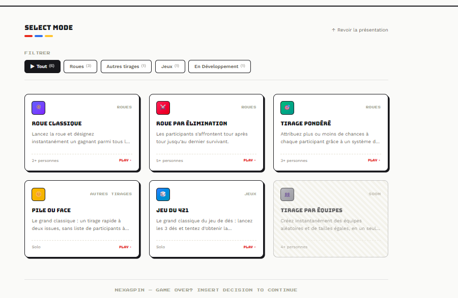
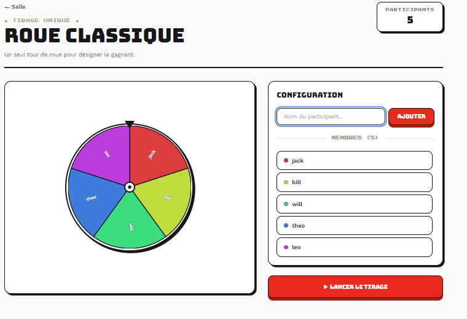
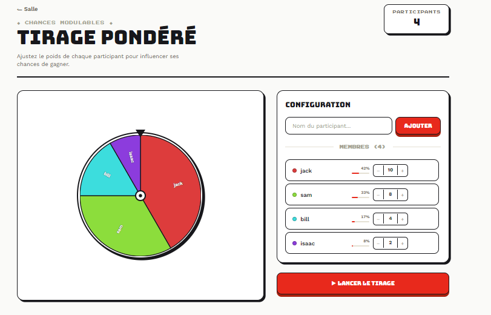
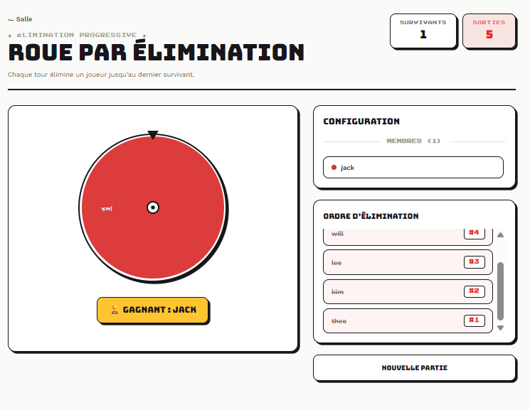
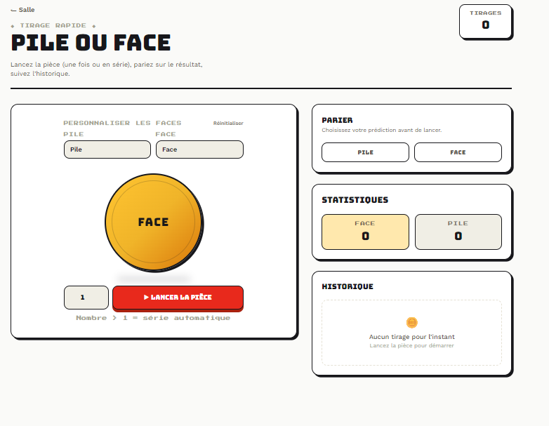
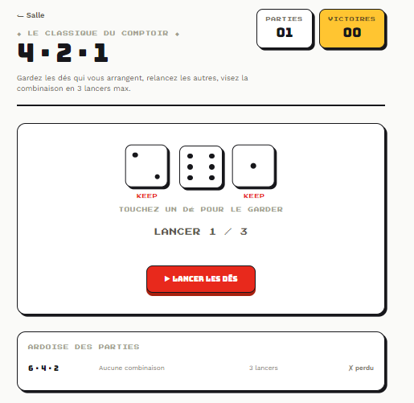

<div align="center">
<h1>🎲 NexaSpin </h1>


**Une boîte à outils de tirages au sort, de jeux et d'outils pour animer un groupe — et un terrain d'apprentissage pour une architecture propre**

[](https://php.net)
[](https://laravel.com)
[](https://livewire.laravel.com)
[](https://tailwindcss.com)
[](https://pestphp.com)
</div>


## 📖 Sommaire
- [📌 Statut du projet](#-statut-du-projet)
- [📸 Aperçu](#-aperçu)
- [🧱 Stack technique](#-stack-technique)
- [🏗️ Architecture](#️-architecture)
  - [Découpage par domaine métier](#découpage-par-domaine-métier)
  - [Principe directeur](#principe-directeur)
  - [Patterns clés](#patterns-clés)
- [🎯 Pourquoi cette architecture ?](#-pourquoi-cette-architecture-pour-une-boîte-à-outils-de-tirages-et-de-jeux-)
- [🔍 Exemple concret : un tirage pondéré](#-ce-qui-se-passe-réellement-quand-on-lance-un-tirage-pondéré)
- [⚠️ Dette technique et limites connues](#-dette-technique-et-limites-connues)
  - [Fonctionnel mais incomplet](#-fonctionnel-mais-incomplet)
  - [Code mort / ébauche non branchée](#-code-mort--ébauche-non-branchée)
  - [Corrigé récemment](#-corrigé-récemment)
- [📚 Ce que ce projet m’a servi à travailler](#-ce-que-ce-projet-ma-servi-à-travailler)
- [🚀 Installation](#-installation)
- [🧪 Tests et qualité de code](#-tests-et-qualité-de-code)
- [🗺️ Pistes pour la suite](#️-pistes-pour-la-suite)
- [💡 Pourquoi documenter les limites ?](#-pourquoi-ce-readme-documente-t-il-les-limites-)

---

## 📌 Statut du projet
*Terrain d’expérimentation : partir d’un simple tirage au sort, puis l’étendre à des jeux et des outils pour se concentrer sur l’architecture.*

L’accueil regroupe les modes en sections (`GameModeCategory`) : **Roues**, **Autres tirages**, **Jeux**, **Outils** et **En développement**.

### 🎡 Roues
| Mode | Description | État | Détails |
| --- | --- | --- | --- |
| 🎡 Roue classique | Tirage aléatoire simple et rapide pour désigner un seul gagnant. | ✅ Fonctionnel | `WheelPage` (`/roue`). |
| ⚔️ Roue par élimination | Élimination progressive des participants jusqu'à ce qu'il n'en reste qu'un. | ✅ Fonctionnel | `EliminationWheelPage` (`/roue-elimination`). |
| 🎯 Roue pondérée | Tirage aléatoire où chaque participant a un poids personnalisé pour influencer les résultats. | ✅ Fonctionnel | `WeightedWheelPage` (`/roue-ponderee`). Les segments de la roue sont proportionnels aux poids. |

### 🎟️ Autres tirages
| Mode | Description | État | Détails |
| --- | --- | --- | --- |
| 🪙 Pile ou face | Simule un lancer de pièce équitable entre deux options, avec système de paris (pile/face) et libellés personnalisables. | ✅ Fonctionnel | `CoinFlipPage` (`/pile-ou-face`), `FlipCoinAction`. |
| 👥 Tirage par équipes | Répartit les participants en N équipes tirées au sort ; les participants excédentaires deviennent des remplaçants non assignés. | ✅ Fonctionnel | `TeamsGenerator`, `TeamsPage` (`/equipes`). |
| 🎟️ Tombola | Tirage pondéré sans remise de plusieurs lots, en une fois ou lot par lot. | ✅ Fonctionnel | `DrawLotAction`, `TombolaPage` (`/tombola`). |

### 🕹️ Jeux
| Mode | Description | État | Détails |
| --- | --- | --- | --- |
| 🎲 421 (dés) | Jeu de dés classique : gardez les dés qui vous arrangent, relancez les autres, visez la combinaison 4-2-1 en 3 lancers maximum. | ✅ Fonctionnel | `RollDiceAction`, `FourTwoOneStrategy`, `Dice421Page` (`/421`). |
| 🔢 Roulette numérique | Roulette américaine (0, 00, 1-36) avec mises casino (plein, chances simples, douzaines, colonnes) et cagnotte persistée (1 000 au départ). | ✅ Fonctionnel | `RoulettePocket`, `RouletteBetEvaluator`, `BankrollStore`, `NumberRoulettePage` (`/roulette`). |
| ✂️ Pierre-feuille-ciseaux | Manche après manche contre un adversaire local (2 joueurs au même écran) ou une IA aléatoire, au choix. | ✅ Fonctionnel | `RpsPage` (`/pierre-feuille-ciseaux`), historique groupé par partie via `HistoryStore::pushSession()`. |
| ⭕ Morpion | Grille 3×3 classique, à deux joueurs locaux ou contre une IA (minimax) avec trois niveaux : Facile, Moyen, Imbattable. | ✅ Fonctionnel | `TicTacToePage` (`/morpion`), `HeuristicTicTacToeStrategy`, `DifficultyLevel`, historique groupé par partie. |
| 🔐 Nombre secret | Devinez un nombre avec des indices « plus » / « moins ». Trois variantes : **solo** (l'IA choisit le nombre), **duel** (2 à 10 joueurs, même nombre pour tous, chacun joue à son tour, le moins d'essais gagne) et **versus** (2 joueurs, chacun fait deviner son nombre à l'autre, rôles inversés). Plage (0 à 1 000 par défaut, jusqu'à 1 000 000) et nombre d'essais (illimité par défaut) configurables. | ✅ Fonctionnel | `SecretNumberGame` (entité), `SecretNumberPage` (`/secret-number`), écran de passage d'appareil entre joueurs, nombre secret conservé côté serveur (`SecretNumberGameStore`). |
| 🥢 Jeu des bâtonnets | Jeu de Nim : ne prenez pas le dernier bâtonnet, contre l'IA ou à deux. | 🚧 Annoncé | Carte grisée sur l'accueil, pas de route ni de composant. |
| 📦 Boîte maudite | Choisissez une boîte mystère : trésor ou malédiction. | 🚧 Annoncé | Carte grisée sur l'accueil, pas de route ni de composant. |

### 🧰 Outils
| Mode | Description | État | Détails |
| --- | --- | --- | --- |
| 🛡️ Tournoi à double élimination | Tableau principal (Upper Bracket) + tableau de repêchage (Lower Bracket) et grande finale. | ✅ Fonctionnel | `DoubleEliminationBracket`, `DoubleEliminationBracketPage` (`/bracket`). |
| 🔄 Phase de poules | Répartition automatique en poules équilibrées (round-robin complet, taille calculée à partir du nombre de participants). | ✅ Fonctionnel | `PoolStage`, `PoolStagePage` (`/poules`). |
| 🎲 Lanceur de dés | Choix d’un type de dé façon JDR (d4 à d100) et du nombre de dés à lancer d’un coup. | ✅ Fonctionnel | `DiceRollerPage` (`/lanceur-de-des`). Volontairement exclu de l’historique en cache (pas de notion de « gagnant », résultats jetables). |

> **Historique des tirages en cache** : chaque partie ou tirage (tous les modes sauf le lanceur de dés) est conservé côté serveur dans le cache (`App\Application\History\HistoryStore`), rattaché à la session du visiteur (1 mois de rétention, 1 000 entrées maximum par mode). Page `/historique` : liste unifiée, filtrable **par mode** ou **par catégorie**, avec popup de détails (participants, poids, ordre des éliminations, essais du nombre secret…). Un résumé rapide des derniers tirages est aussi affiché directement sur chaque page de mode.
> **Aucune persistance en base de données** : les participants et résultats vivent dans l’état des composants Livewire (session uniquement) ; seuls l’historique, la cagnotte de la roulette, la progression des tournois et la partie de nombre secret en cours passent par le cache, sans table dédiée.
> **Déploiement continu** : synchronisation automatique de `master` vers un VPS via GitHub Actions (sans porte de qualité, voir [Dette technique](#-dette-technique-et-limites-connues)).
> **Accueil organisé par catégorie** : les sections sont générées dynamiquement à partir de `GameModeType::grouped()` — ajouter un mode ou une catégorie n’implique aucune modification de la vue. Les modes non disponibles (`available: false`) s'affichent en carte grisée.

---

## 📸 Aperçu

| Accueil | Roue classique |
|---|---|
|  |  |

| Roue pondérée | Roue par élimination |
|---|---|
|  |  |

| Pile ou face | 421 |
|---|---|
|  |  |

> Les captures n'ont pas été refaites pour les modes ajoutés depuis (équipes, tombola, roulette, tournois, Pierre-feuille-ciseaux, Morpion, Nombre secret, Lanceur de dés).

---

## 🧱 Stack technique

| Catégorie | Technologies |
|----------|--------------|
| **Backend** | PHP 8.4 · Laravel 13 |
| **Interactivité** | Livewire 4 + Alpine.js (JS dédié pour l'animation des dés du 421, voir `resources/js/dice-game.js`) |
| **Frontend** | Tailwind CSS 4 (via `@tailwindcss/vite`) · Vite 8 |
| **Tests** | Pest 4 (avec plugin Laravel) |
| **Analyse statique** | Larastan / PHPStan (niveau 5, dossier `app/` hors `Providers`) |
| **Style de code** | Laravel Pint |
| **CI/CD** | GitHub Actions → déploiement `rsync` sur VPS |
| **Polices** | Work Sans, Bungee, Press Start 2P — auto-hébergées via `laravel-vite-plugin` (Bunny Fonts), sans appel externe |
| **SEO** | Meta title/description, Open Graph et Twitter Card par page, sitemap.xml généré à partir des routes via `spatie/laravel-sitemap` (`php artisan sitemap:generate`), `robots.txt` |

---

## 🏗️ Architecture
*Séparation Domain / Application / UI, inspirée de la Clean Architecture et du DDD léger.*

### Découpage par domaine métier
```
app/
├── Domain/Shared/Collections/   # ParticipantsCollection (générique, @template) : itération/comptage/
│                                 # validation de type communs à toutes les collections de participants
│                                 # par domaine ; chaque domaine fournit son Participant et sa propre
│                                 # exception via itemClass()/invalidItemException(), sans coupler les
│                                 # domaines entre eux au niveau métier
│
├── Domain/Draw/               # Règles métier pures (0 dépendance à Laravel)
│   ├── Entities/              # Draw (garantit l'invariant "≥ 2 participants")
│   ├── ValueObjects/          # Participant (nom + poids), DrawResult (immuables)
│   ├── Collections/           # Participants (étend Shared\ParticipantsCollection, ajoute first()/random())
│   ├── Enums/                 # DrawType (Random, Weighted), DrawDisplay
│   ├── Strategies/            # RandomDrawStrategy, WeightedDrawStrategy
│   ├── Support/               # WeightedRandomPicker (tirage pondéré hors de l'entité `Draw`, ex. un seul candidat restant)
│   ├── Contracts/             # DrawStrategy (interface)
│   └── Exceptions/
│
├── Domain/CoinFlip/           # Même logique appliquée au pile ou face
│   ├── Enums/                 # CoinSide
│   ├── ValueObjects/          # CoinFlipResult, CoinFlipBet (règle gagné/perdu)
│   ├── Strategies/            # RandomCoinFlipStrategy
│   └── Contracts/             # CoinFlipStrategy
│
├── Domain/Dice/               # Jeu de dés (421)
│   ├── Enums/                 # DiceCombination (421, Brelan, Suite, Aucune)
│   ├── ValueObjects/          # DiceRoll, DiceThrowResult (immuables)
│   ├── Support/               # DiceCombinationEvaluator (détection de combinaison)
│   ├── Strategies/            # FourTwoOneStrategy (règles du 421 classique), SuiteExpressStrategy (ébauche non branchée)
│   └── Contracts/             # DiceGameStrategy
│
├── Domain/DiceRoller/         # Lanceur de dés JDR
│   ├── Enums/                 # DiceFaceCount (d4 à d100)
│   ├── ValueObjects/          # DiceRollResult
│   └── Exceptions/            # InvalidDiceRollException
│
├── Domain/Roulette/           # Table des cases de la roulette américaine
│   ├── RoulettePocket.php     # Couleur, parité, douzaine, colonne pour chaque case
│   └── Enums/RouletteBetType.php # Types de mises + multiplicateurs de gain
│
├── Domain/RockPaperScissors/  # Pierre-feuille-ciseaux
│   ├── Enums/                 # RpsChoice, RpsOutcome, RpsOpponentType (IA / Local)
│   ├── Strategies/            # RandomRpsStrategy
│   ├── Contracts/             # RpsOpponentStrategy
│   └── ValueObjects/          # RpsResult
│
├── Domain/TicTacToe/          # Morpion
│   ├── Entities/              # Board (grille 3×3, détection de victoire/nul)
│   ├── Enums/                 # Mark, TicTacToeOpponentType (IA / Local), DifficultyLevel (Facile/Moyen/Imbattable)
│   ├── Strategies/            # HeuristicTicTacToeStrategy (IA : minimax + taux d'erreur selon le niveau)
│   ├── Contracts/             # TicTacToeOpponentStrategy
│   └── Exceptions/            # InvalidMoveException
│
├── Domain/SecretNumber/       # Nombre secret (solo / duel / versus)
│   ├── Entities/              # SecretNumberGame (machine à états : choix du secret → passage d'appareil → jeu → fin ;
│   │                          # indices plus/moins, classement du duel, manches du versus)
│   ├── ValueObjects/          # SecretNumberRange (bornes 0 à 1 000 000), SecretNumberPlayers (2 à 10 joueurs, noms normalisés)
│   ├── Enums/                 # SecretNumberMode, SecretNumberPhase, SecretNumberHandoffPurpose
│   └── Exceptions/            # InvalidSecretNumberGameException
│
├── Domain/Tournament/         # Règles métier des formats de tournoi
│   ├── Bracket/               # Entities (BracketMatch, DoubleEliminationBracket : Upper/Lower Bracket + grande finale) + Exceptions
│   ├── Pool/                  # Entities (Pool, PoolMatch, PoolStage : répartition + round-robin équilibré) + Exceptions
│   ├── Collections/           # Participants (étend Shared\ParticipantsCollection)
│   └── ValueObjects/          # Participant
│
├── Application/Draw/          # Orchestration (pont Domain ↔ UI)
│   ├── Actions/               # RunDrawAction (construit `Draw`, délègue à la stratégie)
│   ├── DTOs/                  # DrawData (transmet les données de l’UI au Domain)
│   ├── Resolvers/             # DrawStrategyResolver (point d'entrée unique)
│   └── Support/               # WheelSegmentBuilder (segments SVG + rotation cumulée)
│
├── Application/CoinFlip/      # Orchestration du pile ou face
│   └── Actions/               # FlipCoinAction
│
├── Application/Dice/          # Orchestration du 421
│   └── Actions/               # RollDiceAction (relance les dés non gardés, détecte fin de partie)
│
├── Application/DiceRoller/    # Orchestration du lanceur de dés JDR
│   └── Actions/               # RollDiceSetAction (d4 à d100, N dés d'un coup)
│
├── Application/Teams/         # Tirage par équipes
│   └── TeamsGenerator.php     # Répartit les participants en N équipes + remplaçants
│
├── Application/Tombola/       # Orchestration du tirage de lots
│   ├── Actions/               # DrawLotAction (tirage pondéré, avec/sans remise ; délègue à RunDrawAction dès que possible)
│   └── DTOs/                  # LotDrawResult
│
├── Application/Roulette/      # Orchestration de la roulette numérique
│   ├── RouletteBetEvaluator.php # Détermine si une mise est gagnante
│   └── BankrollStore.php      # Cagnotte persistée en cache, rattachée à la session
│
├── Application/RockPaperScissors/ # Orchestration du pierre-feuille-ciseaux
│   └── Actions/               # PlayRpsRoundAction
│
├── Application/TicTacToe/     # Orchestration du morpion
│   └── Actions/               # ChooseAiMoveAction, ReplayMovesAction (reconstruction du plateau)
│
├── Application/SecretNumber/  # Orchestration du nombre secret
│   ├── Actions/               # CreateSecretNumberGameAction, ChooseSecretNumberAction, SubmitSecretNumberGuessAction,
│   │                          # ContinueSecretNumberAfterHandoffAction, RecordSecretNumberResultAction (archive en historique)
│   └── SecretNumberGameStore.php # Partie en cours en cache (6 h), le nombre secret ne quitte jamais le serveur
│
├── Application/Tournament/    # Orchestration des tournois
│   ├── Bracket/Actions/       # Create/Rebuild/RecordMatchResult (double élimination)
│   ├── Pool/Actions/          # Create/Rebuild/RecordMatchResult (poules)
│   ├── DTOs/                  # ParticipantListData
│   └── TournamentProgressStore.php # Sauvegarde de la progression en cache (comme HistoryStore)
│
├── Application/History/       # Historique des parties/tirages (transverse à tous les modes sauf le lanceur de dés)
│   └── HistoryStore.php       # Lecture/écriture en cache, rattaché à la session (push/pushSession/all/allModes/clear)
│
├── Application/Home/          # Read-model de la page d'accueil
│   ├── DTOs/                  # GameMode (carte affichée sur la home)
│   └── Enums/                 # GameModeType, GameModeCategory (regroupement de la home)
│
├── Http/
│   ├── Controllers/HomeController.php
│   └── Middleware/SecurityHeaders.php # CSP (prod uniquement) + en-têtes de sécurité HTTP
│
├── Console/Commands/
│   └── GenerateSitemap.php    # Commande `sitemap:generate` — découvre les routes GET publiques automatiquement
│
├── View/Components/
│   └── ModeCard.php           # Carte de mode de l'accueil
│
└── Livewire/
    ├── Draw/                  # WheelPage, EliminationWheelPage, WeightedWheelPage
    │   └── Concerns/          # ManagesParticipants, HandlesDraw (traits partagés)
    ├── CoinFlip/CoinFlipPage.php          # Tirage simple/multiple + paris + libellés personnalisables
    ├── Dice/Dice421Page.php               # Partie de 421 : lancers, dés gardés, historique local
    ├── DiceRoller/DiceRollerPage.php      # Lanceur de dés JDR (/lanceur-de-des), pas d'historique
    ├── RockPaperScissors/RpsPage.php      # Pierre-feuille-ciseaux, adversaire local ou IA (/pierre-feuille-ciseaux)
    ├── TicTacToe/TicTacToePage.php        # Morpion, adversaire local ou IA + niveau (/morpion)
    ├── SecretNumber/SecretNumberPage.php  # Nombre secret : réglages, passage d'appareil, essais, classement (/secret-number)
    ├── Teams/TeamsPage.php                # Répartition en équipes (/equipes)
    ├── Tombola/TombolaPage.php            # Tirage de lots, pondéré sans remise (/tombola)
    ├── Roulette/NumberRoulettePage.php    # Roulette américaine + cagnotte (/roulette)
    ├── Tournament/
    │   ├── Bracket/DoubleEliminationBracketPage.php # /bracket
    │   └── Pool/PoolStagePage.php                   # /poules
    └── History/HistoryPage.php            # Page /historique : liste unifiée, filtres par mode ou par catégorie
```

> **Nomenclature** : les DTO/enums de la home s'appellent `GameModeType` / `GameModeCategory` (et non plus `DrawModeType` / `DrawModeCategory`), car l'application ne propose plus seulement des *tirages* mais aussi des jeux et des outils.

### Principe directeur
- **Domain** : Ignore Laravel/Livewire. Testable en PHP pur.
- **Application** : Orchestre les cas d’usage (ex. : `RunDrawAction` construit `Draw` puis appelle `$strategy->draw()`).
- **Livewire** : Gère uniquement l’état UI et délègue la logique métier.

### Patterns clés
- **Strategy** : `RandomDrawStrategy` et `WeightedDrawStrategy` implémentent `DrawStrategy` ; l'adversaire du pierre-feuille-ciseaux et l'IA du morpion suivent le même principe. Pour les tirages, le branchement se fait en un seul point (`DrawStrategyResolver::resolve()`).
- **Double Dispatch** : `Draw::execute($strategy)` délègue à la stratégie sans connaître son implémentation.
- **Always-Valid Entity** : `Draw` valide ses invariants (ex. : ≥ 2 participants) dans son constructeur ; `SecretNumberGame` refuse toute action hors de la phase attendue.
- **DTO** : `DrawData` transmet les données de l’UI au Domain sans couplage.
- **Machine à états** : `SecretNumberGame` pilote ses phases (`SecretNumberPhase`) ; l'UI ne fait que refléter l'état public de l'entité.
- **Store en cache** : `HistoryStore`, `BankrollStore`, `TournamentProgressStore` et `SecretNumberGameStore` isolent la persistance en cache, rattachée à la session, hors des composants Livewire.

---

## 🎯 Pourquoi cette architecture pour une boîte à outils de tirages et de jeux ?
*Un tirage au sort tient en 30 lignes avec `array_rand()`. Découper le code en couches ajoute de la complexité... mais c’est voulu.*

### Avantages
- **Testabilité** : Le Domain se teste sans base de données, sans HTTP, sans Livewire.
- **Portabilité** : `Draw`, `Participant`, `RandomDrawStrategy` pourraient être copiés dans un projet PHP sans Laravel.
- **Évolutivité** : Ajouter une nouvelle stratégie de tirage (ex. : sans remise) ne nécessite que :
  1. Une nouvelle stratégie implémentant `DrawStrategy`.
  2. Une entrée dans `DrawType`.
  3. Une route et un composant Livewire.

  *(Ça ne vaut que pour un nouveau type de tirage au sens strict — les modes ajoutés depuis, comme les équipes, la tombola, les jeux ou les tournois, ont leur propre logique dédiée plutôt que de réutiliser `Draw`/`DrawStrategy`. Ajouter un mode complet demande : un domaine, des actions Application, un composant Livewire, une route, un cas dans `GameModeType`, et si besoin un branchement sur `HistoryStore`.)*

### Coûts assumés
- **Plus de fichiers** : 1 fonctionnalité simple = plus de couches, plus d’indirection.
- **Courbe d’apprentissage** : Un nouveau contributeur doit comprendre la structure avant de modifier le code.
- **Risque de bugs** : Plus de couches = plus d’endroits où une intention peut se perdre (ex. : le bug du tirage pondéré, voir ci-dessous).

> **Le compromis** : Ce projet n’est pas optimisé pour la livraison rapide, mais pour **comprendre où cette architecture aide et où elle coûte**.

---

## 🔍 Ce qui se passe réellement quand on lance un tirage pondéré
*Exemple concret de trajet à travers les couches :*

1. **`WeightedWheelPage`** (Livewire) : Surcharge `drawType()` pour retourner `DrawType::WEIGHTED`.
2. **`HandlesDraw::executeDraw()`** : Construit un `DrawData` (DTO) avec les participants, leurs poids, et appelle `$this->drawType()` pour transmettre le bon type.
3. **`RunDrawAction::execute()`** :
   - Demande à `DrawStrategyResolver` la stratégie pour `DrawType::WEIGHTED`, qui résout bien `WeightedDrawStrategy`.
   - Construit l’entité `Draw` à partir de `$data->participantsCollection()`. Le constructeur valide qu’il y a ≥ 2 participants.
4. **`Draw::execute($strategy)`** : Délègue à `$strategy->draw($this->participants)` (Double Dispatch).
5. **`WeightedDrawStrategy::draw()`** :
   - Calcule la somme des poids.
   - Tire un `random_int(1, $totalWeight)`.
   - Parcourt les participants en cumulant leurs poids jusqu’à dépasser le nombre tiré (algorithme *Roulette Wheel Selection*).
6. **Résultat** : Le `DrawResult` (Value Object immuable) remonte jusqu’à Livewire pour mise à jour de l’affichage.
   - **En parallèle** : `WheelSegmentBuilder` calcule la taille des segments SVG **proportionnellement aux poids** (les parts inégales sont visibles à l’écran).
   - **Après l'animation** : le résultat n'est écrit dans `HistoryStore` qu'une fois l'animation terminée côté client, pour ne pas révéler le gagnant avant la fin de la roue.

---

## ⚠️ Dette technique et limites connues

### 🟡 Fonctionnel mais incomplet
- **Déploiement sans porte de qualité** : Le workflow GitHub Actions déploie directement sur `master` sans exécuter `composer test` ou `composer run analyse`.
- **`sitemap.xml` versionné périmé** : le fichier `public/sitemap.xml` committé pointe sur `http://localhost` et ne liste que 6 pages. Le workflow de déploiement n'exécute pas `php artisan sitemap:generate` : à lancer sur le serveur (avec le bon `APP_URL`) ou à ajouter à `deploy.yml`.
- **Couverture de tests inégale** : le morpion n'a qu'un test du plateau (`BoardTest`, pas de test de la page ni de l'IA), le pierre-feuille-ciseaux un seul fichier, et le lanceur de dés seulement son action. Le test de fumée des routes (`RoutesTest`) ne charge ni `/pierre-feuille-ciseaux`, ni `/morpion`, ni `/lanceur-de-des`.
- **Pas de persistance** : Les tirages ne sont pas sauvegardés en base de données (choix assumé pour l’instant).
- **Parties de nombre secret non reprenables** : la partie vit 6 h en cache et n'est pas récupérable après rechargement ou expiration de la session.
- **Méta-description de `/historique` incomplète** : elle ne cite que pile ou face, 421 et les roues, alors que la page couvre tous les modes.
- **Deux modes annoncés mais absents** : Jeu des bâtonnets et Boîte maudite ne sont que des cartes grisées (`available: false`). La catégorie « En développement » (`GameModeCategory::DEV`) existe mais ne contient aucun mode pour l'instant.

### 🟠 Code mort / ébauche non branchée
- **`SuiteExpressStrategy`** (`app/Domain/Dice/Strategies/`) : variante du 421 (viser une Suite en 2 lancers) entièrement écrite au niveau Domain, avec sa vue Blade dédiée (`resources/views/livewire/dice/suite-express-page.blade.php`, 175 lignes) — mais **jamais branchée** : pas d'action `Application`, pas de composant Livewire, pas de route, pas de carte sur l'accueil. À finir ou à supprimer selon l'intérêt du mode.

### ✅ Corrigé récemment
*Historique complet (y compris les correctifs plus anciens) dans la section « 📜 Historique des commits clés » plus bas.*
- **Nouveau mode Nombre secret** : solo, duel (2 à 10 joueurs) et versus, avec entité `SecretNumberGame` (machine à états), nombre secret gardé côté serveur (`SecretNumberGameStore`), écran de passage d'appareil, historique détaillé (essais, classement, manches) et tests dédiés (`tests/Feature/SecretNumber/`).
- **Morpion : trois niveaux d'IA** (`DifficultyLevel` : Facile, Moyen, Imbattable) sur la stratégie minimax, et historique groupé par partie, comme le pierre-feuille-ciseaux (choix adversaire local / IA).
- **`phpstan.neon` simplifié** : la déduplication des collections de participants (`Domain\Shared\Collections\ParticipantsCollection`) a permis de supprimer les deux règles `ignoreErrors` qui justifiaient l'ancien garde-fou ; il n'y a plus aucune exception volontaire à documenter.
- **Collections de participants dédupliquées** : `Domain\Draw\Collections\Participants` et `Domain\Tournament\Collections\Participants` étaient quasi identiques ; elles partagent désormais une classe abstraite générique (`@template T of object`), chaque domaine ne fournissant que son `itemClass()` et son `invalidItemException()`, sans coupler les deux domaines.
- **Passe de cohérence sur toute la codebase** : `vendor/bin/pint` appliqué sur l'ensemble du projet, code mort supprimé (constante `CoinFlipPage::SIDES` inutilisée, vérifications `isset() && !== null` redondantes, `?? []` sans effet).
- **Historique en cache unifié** : `HistoryStore` enregistre chaque tirage (tous modes) rattaché à la session ; page `/historique` filtrable par mode/catégorie ; le résultat n'atterrit dans l'historique qu'après la fin de l'animation côté client, pour ne pas spoiler avant l'animation.
- **Tombola alignée sur l'architecture Domain/Application** : le tirage pondéré (avec le cas particulier à un seul candidat restant) est extrait dans `Domain\Draw\Support\WeightedRandomPicker` et `Application\Tombola\Actions\DrawLotAction`, au lieu de vivre dans le composant Livewire.
- **Durcissement sécurité/aléatoire** : `NumberRoulettePage::$bankroll` verrouillée (`#[Locked]`) contre un payload Livewire forgé ; `TeamsGenerator` utilise `random_int()` (CSPRNG) au lieu de `shuffle()` ; `CoinFlipPage::$bet` verrouillée de la même façon.
- **Suite de tests Pest étendue à presque tous les modes** : voir la section « 🧪 Tests et qualité de code » plus bas.

---

## 📚 Ce que ce projet m’a servi à travailler
*Une liste non exhaustive des concepts et bonnes pratiques appliqués.*

| Concept | Implémentation dans NexaSpin |
|---------|-------------------------------|
| **Séparation des couches** | Domain (règles métier) / Application (orchestration) / UI (Livewire). |
| **Entity vs Value Object** | `Draw` (Entity avec identité et invariants) vs `Participant`/`DrawResult` (Value Objects immuables). |
| **Pattern Strategy** | `RandomDrawStrategy` et `WeightedDrawStrategy` derrière l’interface `DrawStrategy` ; adversaires IA du pierre-feuille-ciseaux et du morpion. |
| **Double Dispatch** | `Draw::execute($strategy)` délègue à la stratégie sans connaître son type. |
| **DTO** | `DrawData` pour transmettre des données de l’UI au Domain sans couplage. |
| **Machine à états** | `SecretNumberGame` et ses phases (choix du secret, passage d'appareil, jeu, fin). |
| **Traits PHP** | `ManagesParticipants`, `HandlesDraw` pour éviter la duplication entre composants Livewire. |
| **Génériques via PHPDoc** | `ParticipantsCollection` (`@template T of object`) partagée entre les domaines Draw et Tournament. |
| **Génération SVG dynamique** | `WheelSegmentBuilder` calcule les coordonnées polaires → cartésiennes pour la roue. |
| **Algorithmes** | Roulette Wheel Selection (tirage pondéré, `random_int`), minimax (IA du morpion), round-robin équilibré (poules), tableaux Upper/Lower Bracket. |
| **Persistance sans base** | Stores en cache rattachés à la session (`HistoryStore`, `BankrollStore`, `TournamentProgressStore`, `SecretNumberGameStore`). |
| **Tests Livewire** | Couverture des composants (ajout/suppression/édition de participants, tirages, parties). |
| **Analyse statique** | Larastan/PHPStan niveau 5, sans `ignoreErrors`. |
| **CI/CD** | Déploiement automatique via GitHub Actions (à améliorer avec des portes de qualité). |
| **En-têtes de sécurité HTTP** | Middleware `SecurityHeaders` (CSP conditionnelle à l’environnement, `X-Frame-Options`, etc.) + `throttle` sur les routes de jeu. |
| **Read-model + regroupement par enum** | `GameModeCategory` pilote les sections de la home ; `GameModeType::grouped()` reste la seule source de vérité, la vue ne fait qu’itérer. |

<details>
<summary><strong>📜 Historique des commits clés</strong></summary>
<br>

| Commit | Apport |
|--------|--------|
| `init roulette v2` | Reprise d’une v1 plus simple. |
| `add livewire` | Introduction de Livewire pour l’interactivité. |
| `Domain` puis `Application` | Extraction des règles métier hors des composants Livewire. |
| `Début UI` + `debug + ajout roue visuel` | Construction de la roue en SVG généré côté serveur. |
| `elimination` | Mode multi-étapes avec confirmation d’animation. |
| `refonte` + `rename drawfactory` | Retour sur des noms et une structure plus cohérents. |
| `merge factory/resolver` | Fusion des mécanismes concurrents de résolution de stratégie. |
| `fix setup script + tests` | Réparation de `composer run setup`, `phpunit.xml`, et tests Livewire. |
| `WeightedDrawStrategy + WeightedWheelPage` | Implémentation du tirage pondéré et de son écran dédié. |
| `wire Draw entity into RunDrawAction` | `RunDrawAction` passe par l’entité `Draw` (Double Dispatch). |
| `test updateParticipant + Larastan + deploy.yml` | Couverture de l’édition inline, analyse statique, et pipeline de déploiement. |
| `tirage ponderer segment = poids` | Correction du bug : les segments SVG suivent enfin les poids réels. |
| `implémentation Coin Flip` | Ajout du mode Pile ou face (`FlipCoinAction`, `RandomCoinFlipStrategy`, `CoinFlipPage`), désormais actif sur l’accueil. |
| `Label coin flip` + `paris` | Ajout des paris pile/face et des libellés de faces personnalisables. |
| `Securité` | `SecurityHeaders` (CSP prod-only), `throttle` sur les routes de tirage, `random_int()` au lieu d’`array_rand()`, verrouillage de `CoinFlipPage::$bet`. |
| `debug wheel a la relance de la roue` | Correction du bug de rotation absolue vs cumulative sur `WheelPage`/`WeightedWheelPage`, ajout du détecteur de blocage sur `EliminationWheelPage`. |
| `accueil par catégories` | `GameModeCategory` + `GameModeType::grouped()` : sections de la home générées dynamiquement. |
| `accueil responsive mobile` | Colonnes auto-adaptatives, accordéon Alpine.js par catégorie sur mobile, carte compacte dédiée, hover limité à `md:`. |
| `implémentation 421` + `Debug 421` + `test 421` | Ajout du jeu de dés 421 et de sa suite de tests. |
| `design type borne arcade` + `redisign` | Refonte visuelle néo-brutaliste « borne d’arcade » : nouvelle palette à ombres dures, nouvelles polices auto-hébergées (Work Sans, Bungee, Press Start 2P), nouveaux utilitaires CSS, ajout du logo. |
| `attendre fin annimation pour compteur et historique` | Historique et compteur du 421 appliqués seulement après la fin de l’animation Alpine (`pendingHistoryEntry` + `finalizeRoll()`). |
| `historique en cache` + `popup details roues` | `HistoryStore`, page `/historique` unifiée et filtrable, résumés rapides par mode, résultat différé après animation, popup de détails (participants/poids/éliminations) pour les roues. |
| `Tombola, Roulette casino, tirage equipe` | Ajout de trois nouveaux modes actifs : Tirage par équipes (`TeamsGenerator`), Tombola (tirage pondéré sans remise), Roulette numérique américaine avec cagnotte persistée (`BankrollStore`). |
| `start bracket` → `bracket` | Implémentation du tournoi à double élimination (`DoubleEliminationBracket`) : Upper/Lower Bracket, gestion des byes, grande finale et match de reset. |
| `refacto bracket` | Ajout de la phase de poules (`PoolStage`) en parallèle du bracket, sous `Application/Tournament`. |
| `add RPS, Tic tac toe et dice JDR` | Ajout de trois modes : Pierre-feuille-ciseaux, Morpion et Lanceur de dés JDR. |
| `IA morpion` | IA du morpion (minimax) avec niveaux de difficulté. |
| `rps history` + `modal historique` | Historique groupé par partie (`pushSession()`) pour le pierre-feuille-ciseaux et le morpion, popup de détails sur `/historique`. |
| `add game secret number` | Ajout du mode Nombre secret (solo / duel / versus), de son domaine, de son historique détaillé et de ses tests. |

</details>

---

## 🚀 Installation

### Prérequis
- PHP 8.4
- Composer
- Node.js 22+ (version utilisée en CI, voir `.github/workflows/deploy.yml`)

### Étapes
```bash
# Cloner le dépôt
git clone https://github.com/DocCreeps/NexaSpinV2.git
cd NexaSpinV2

# Installer les dépendances PHP et générer la clé d'application
composer install
cp .env.example .env
php artisan key:generate

# Installer et builder les assets front
npm install
npm run build
```

**Alternative** : Un script `composer run setup` regroupe toutes ces étapes (sauf la configuration de base de données, non nécessaire).

### Lancement en local
```bash
composer run dev
```
L’application sera accessible sur **[http://localhost:8000](http://localhost:8000)**.

> **Cache et session** : l'historique, la cagnotte de la roulette et les parties en cours s'appuient sur le cache et la session de Laravel (durée de session : `SESSION_LIFETIME=43200`, soit 30 jours). Aucune base de données n'est nécessaire.

---

## 🧪 Tests et qualité de code

### Exécuter les tests
```bash
composer test
```
- Suite de tests Pest (plus de 280 tests) organisée par domaine sous `tests/Feature/` (`Draw/`, `CoinFlip/`, `Dice/`, `DiceRoller/`, `Teams/`, `Tombola/`, `Roulette/`, `RockPaperScissors/`, `TicTacToe/`, `SecretNumber/`, `History/`, `Tournament/`), couvrant :
  - Domain/Application de chaque mode (participants, stratégies de tirage, actions) — cas nominaux et cas d'erreur (effectifs insuffisants, pool vide, mise invalide, plage ou nombre de joueurs invalide...).
  - Composants Livewire (validation, verrouillage des propriétés sensibles, persistance en historique, événements dispatchés) plutôt que leur implémentation interne.
  - Nombre secret : règles de l'entité (indices, classement du duel, manches du versus) et page (passage d'appareil, secret jamais exposé côté client).
  - Tournois à double élimination (y compris effectifs qui ne sont pas une puissance de 2) et phases de poules.
  - Un test de fumée qui charge la page d'accueil et la plupart des pages de mode (`RoutesTest`).
- **Couverture partielle** : le morpion (plateau uniquement), le pierre-feuille-ciseaux et le lanceur de dés sont moins testés que les autres modes, voir [Dette technique](#-dette-technique-et-limites-connues).

### Analyse statique
```bash
composer run analyse
```
- Larastan / PHPStan niveau 5 sur `app/` (hors `app/Providers`).
- Aucune règle `ignoreErrors` : tout le code passe sans exception.

### Style de code
```bash
vendor/bin/pint
```

---

## 🗺️ Pistes pour la suite
*Par ordre de priorité.*

- [ ] **Améliorer le pipeline de déploiement** :
  - Ajouter `composer test` et `composer run analyse` comme portes de qualité dans `deploy.yml`.
  - Générer le sitemap au déploiement (`php artisan sitemap:generate`).
- [ ] **Compléter les tests** : page du morpion et de son IA, pierre-feuille-ciseaux, lanceur de dés, et ajout de ces routes au test de fumée.
- [ ] **Finir les modes annoncés** : Jeu des bâtonnets et Boîte maudite (cartes déjà présentes sur l'accueil).
- [ ] **Trancher le sort de `SuiteExpressStrategy`** : la brancher comme variante du 421 ou la supprimer.
- [ ] **Multijoueur en ligne** *(idée à l'étude)* : jouer à distance au pierre-feuille-ciseaux, au morpion, à la roulette ou au nombre secret via un lien de partie partagé (temps réel avec Laravel Reverb), avec un historique unique.
- [ ] **Design** :
  - Responsive, accessibilité.
  - Refaire les captures d'écran pour les modes récents.
- [ ] **Persistance en base de données** :
  - L'historique des tirages passe aujourd'hui par le cache (rattaché à la session, 1 mois) plutôt qu'une vraie table — suffisant pour l'usage actuel, mais une migration vers une table dédiée permettrait un historique multi-appareils/compte et sans limite de rétention, si un besoin réel émerge.

---

## 💡 Pourquoi ce README documente-t-il les limites ?
*Parce que repérer et assumer les trous fait partie de l’exercice autant que d’écrire le code.*

> *"Un README qui ne mentionne que ce qui marche est un mensonge par omission. Celui-ci liste aussi ce qui est cassé, incomplet, ou à améliorer — pour que le prochain qui lit ce code (moi y compris) sache exactement où en est le projet."*

---

<div align="center">

Fait avec 🎲 par [DocCreeps](https://github.com/DocCreeps)

</div>
